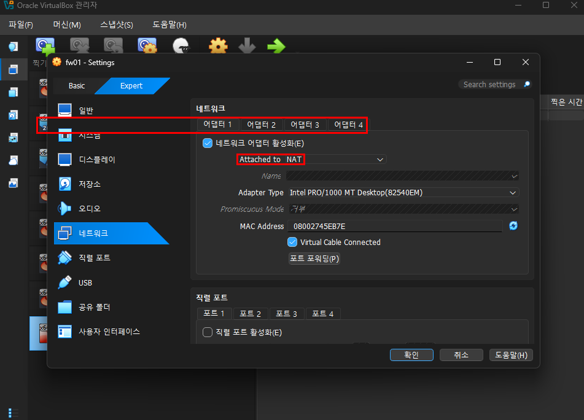
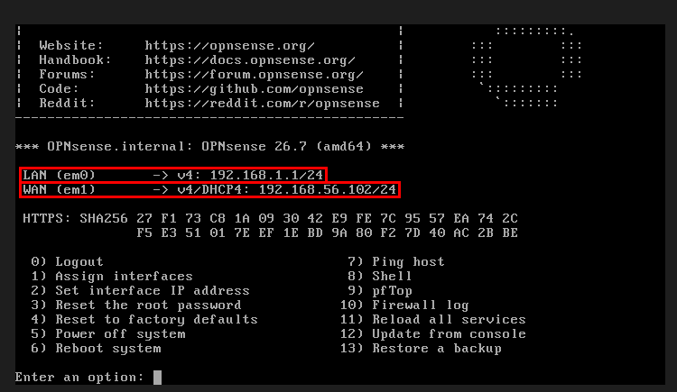
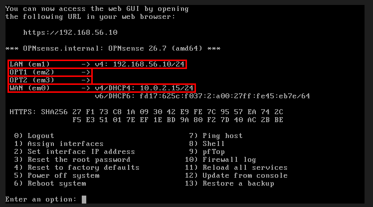
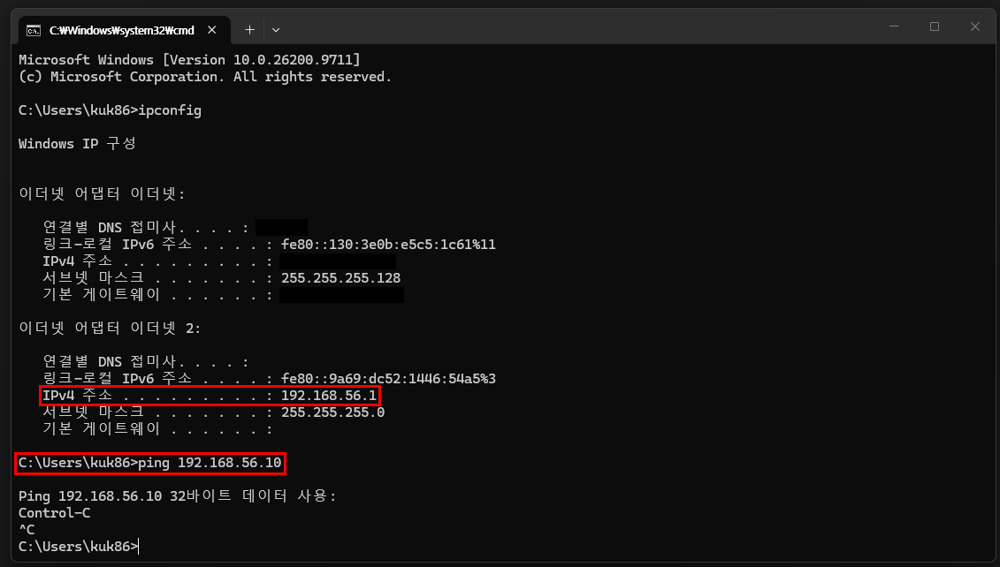
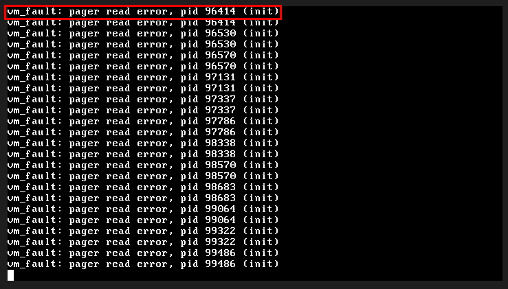
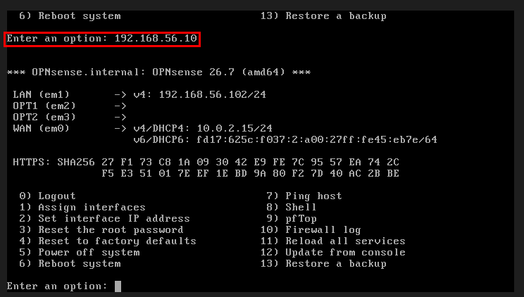
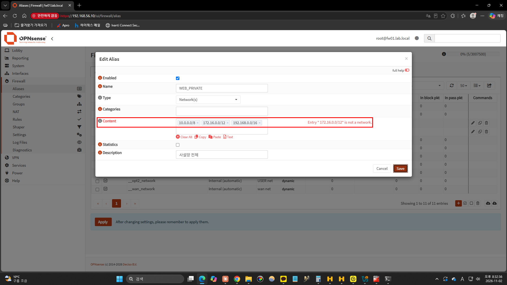
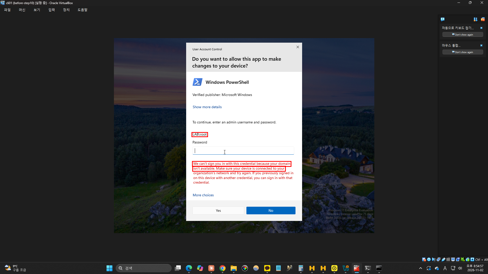
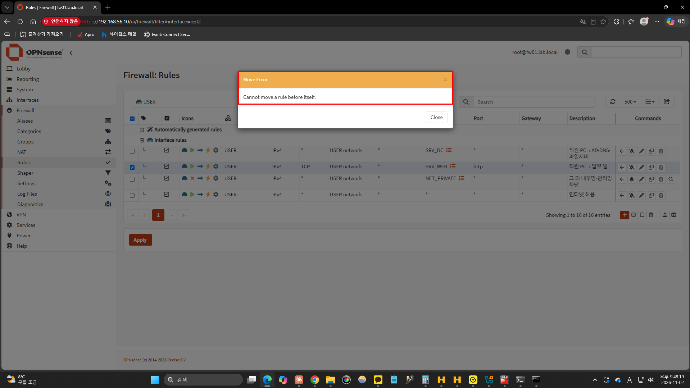

# 08. 방화벽과 망 분리 (OPNsense)


> 실습 매뉴얼 기준 10단계입니다. 매뉴얼의 8~9단계는 정리·면접 대비라 실습 폴더가 없어서, 저장소에서는 08번으로 이어 붙였습니다.

## 목적

모든 VM이 한 네트워크에 섞여 있던 구성을 **관리망 · 서버망 · 직원망** 3개로 나누고, 그 사이에 방화벽(OPNsense)을 두었습니다. "직원 PC는 업무에 필요한 서버·포트에만 접근하고, 서버 관리(SSH, 관리 화면)는 관리망에서만 한다"는 정책을 직접 만들고, 허용·차단이 의도대로 되는지 로그로 확인했습니다. 마지막으로 방화벽 정책 실수와 게이트웨이 다운 장애를 일부러 내서 진단 순서를 연습했습니다.

- 실습일: 2026-11-02
- 방화벽: fw01, OPNsense 26.7 (FreeBSD 기반)
- 진행 상황: **설치 ✅ / 인터페이스 ✅ / 별칭·규칙 ✅ / VM 망 이동 ✅ / 정책 확인 ✅ / 장애 실습 2건 ✅** / VPN(선택)은 생략

## 0. 구성

| 망 | 대역 | fw01 인터페이스 | VirtualBox 네트워크 | 들어 있는 장비 |
|---|---|---|---|---|
| 외부(WAN) | DHCP 10.0.2.15 | em0 | NAT | 인터넷 |
| 관리망(LAN) | 192.168.56.0/24 | em1 = 192.168.56.10 | 호스트 전용 | 내 PC(192.168.56.1) |
| 서버망(SRV) | 10.10.10.0/24 | em2 = 10.10.10.1 | 내부 네트워크 `srvnet` | dc01 .10, lin01 .20, mon01 .30, bak01~03 .71~.73 |
| 직원망(USER) | 10.10.20.0/24 | em3 = 10.10.20.1 | 내부 네트워크 `usernet` | cli01 .100 |

```
            인터넷
              │ em0 (WAN, NAT)
        ┌─────┴─────┐
 내 PC ─┤   fw01    ├─ em2 서버망 10.10.10.0/24 (dc01, lin01, mon01, bak01~03)
 em1    │ OPNsense  │
 관리망  └─────┬─────┘
              │ em3
        직원망 10.10.20.0/24 (cli01)
```

![fw01 VM 어댑터 4개: 1번 NAT(WAN), 2번 호스트 전용(LAN), 3번 srvnet, 4번 usernet]
<!-- 여기에 01-fw01-adapters.png 끌어다 놓기 -->


---

## 10-1 ~ 10-2. 설치와 인터페이스 지정

ISO(`.iso.bz2`라 7-Zip으로 압축 해제)로 설치한 뒤 콘솔에서 인터페이스를 지정했습니다.

| 콘솔 메뉴 | 한 일 |
|---|---|
| `1) Assign interfaces` | WAN = em0, LAN = em1, OPT1 = em2, OPT2 = em3 |
| `2) Set interface IP address` | LAN → `192.168.56.10/24`, DHCP 서버는 끔 |

![설치 후 기본값은 LAN/WAN이 반대(LAN em0 192.168.1.1, WAN em1)]
<!-- 여기에 03-lan-wan-reversed.png 끌어다 놓기 -->


![지정 완료: LAN em1 192.168.56.10, OPT1 em2, OPT2 em3, WAN em0 DHCP]
<!-- 여기에 05-console-assigned.png 끌어다 놓기 -->


내 PC의 호스트 전용 어댑터(`이더넷 2` = 192.168.56.1)에서 `https://192.168.56.10`으로 웹 관리 화면에 접속했습니다.

![내 PC 확인: 호스트 전용 어댑터 192.168.56.1 → fw01 192.168.56.10 (공인 IP는 가림)]
<!-- 여기에 06-host-ip-check.png 끌어다 놓기 -->


마법사(Wizard)에서 호스트 이름 `fw01.lab.local`, LAN IP를 넣고 **LAN DHCP 서버는 껐습니다.** VirtualBox 호스트 전용 네트워크에 이미 DHCP가 있어서, 하나 더 켜면 한 망에 DHCP 서버가 둘이 됩니다. 실무에서 겪은 "직원이 공유기를 꽂아 층 전체가 마비된 장애(Rogue DHCP)"와 같은 구조라 일부러 끄고 진행했습니다.

![마법사 LAN 설정: 192.168.56.10/24, Configure DHCP server 체크 해제]
<!-- 여기에 07-wizard-lan-no-dhcp.png 끌어다 놓기 -->


## 10-3. 서버망 · 직원망 인터페이스

**Interfaces → [OPT1] / [OPT2]**에서 활성화하고 이름과 고정 IP를 넣었습니다.

| 인터페이스 | 장치 | 설명 | IPv4 |
|---|---|---|---|
| opt1 | em2 | SRV | 10.10.10.1/24 |
| opt2 | em3 | USER | 10.10.20.1/24 |

![SRV 인터페이스: opt1, em2, Static IPv4 (Apply 전)]
<!-- 여기에 08-srv-interface.png 끌어다 놓기 -->

![Interfaces Overview: LAN 192.168.56.10, SRV 10.10.10.1, USER 10.10.20.1]
<!-- 여기에 09-interfaces-overview.png 끌어다 놓기 -->

## 10-4. 별칭(Alias)과 방화벽 규칙

IP를 규칙마다 직접 쓰지 않고 이름을 붙여 두면, 서버 IP가 바뀌어도 별칭 하나만 고치면 됩니다.

| 별칭 | 종류 | 내용 |
|---|---|---|
| `SRV_DC` | Host | 10.10.10.10 (AD·DNS·파일서버) |
| `SRV_WEB` | Host | 10.10.10.20 (업무 웹) |
| `NET_PRIVATE` | Network | 10.0.0.0/8, 172.16.0.0/12, 192.168.0.0/16 (사설망 전체) |

![별칭 목록: NET_PRIVATE, SRV_DC, SRV_WEB]
<!-- 여기에 11-aliases.png 끌어다 놓기 -->

### 직원망(USER) 규칙: 위에서부터 순서대로

| # | 동작 | 출발 | 목적지 | 포트 | 설명 |
|---|---|---|---|---|---|
| 1 | 허용 | USER network | SRV_DC | 전체 | 직원 PC → AD·DNS·파일서버 |
| 2 | 허용 | USER network | SRV_WEB | TCP http(80) | 직원 PC → 업무 웹 |
| 3 | **차단(로그)** | USER network | NET_PRIVATE | 전체 | 그 외 내부망·관리망 차단 |
| 4 | 허용 | USER network | 전체 | 전체 | 인터넷 허용 |

순서가 핵심입니다. 방화벽은 위에서부터 보다가 **처음 맞는 규칙 하나만 적용**하므로, 구체적인 허용을 위에, 넓은 차단을 그 아래, 인터넷 허용을 맨 아래에 둡니다.

![USER 규칙 1번 편집: Interface USER, Pass, Source USER network, Destination SRV_DC]
<!-- 여기에 12-user-rule-edit.png 끌어다 놓기 -->

![USER 규칙 4개 완성 (DC 허용 → 업무 웹 허용 → 내부망 차단 → 인터넷 허용)]
<!-- 여기에 13-user-rules.png 끌어다 놓기 -->

### 서버망(SRV) 규칙

| # | 동작 | 출발 | 목적지 | 설명 |
|---|---|---|---|---|
| 1 | **차단(로그)** | SRV network | USER network | 서버에서 직원 PC로 먼저 접속 금지 |
| 2 | 허용 | SRV network | 전체 | 서버 → 인터넷(업데이트 등) |

서버 → 직원 PC를 막았어도 직원 PC가 먼저 요청한 웹 응답은 돌아갑니다. 방화벽이 허용된 연결을 세션 테이블에 기억해 두고, 돌아오는 패킷은 규칙 없이 통과시키기 때문입니다(**상태 기반 방화벽**).

![SRV 규칙 2개 (직원망 차단 → 그 외 허용)]
<!-- 여기에 14-srv-rules.png 끌어다 놓기 -->

![fw01 자체 인터넷 확인: 8.8.8.8 ping 0% 손실]
<!-- 여기에 15-fw01-ping-8888.png 끌어다 놓기 -->

## 10-5. VM을 새 망으로 옮기기

### 내 PC → 서버망 경로 추가

내 PC는 10.10.x.x로 가는 길을 모르기 때문에 "10.10.0.0/16은 fw01(192.168.56.10)로 보내라"는 영구 경로를 추가했습니다.

```powershell
# [호스트 PC, 관리자] 서버망·직원망은 fw01 로 보냄 (-p = 재부팅 후에도 유지)
route -p add 10.10.0.0 mask 255.255.0.0 192.168.56.10
# [호스트 PC] 등록 확인 (영구 경로 목록에 보여야 함)
route print 10.10.*
```

![경로 추가: 10.10.0.0/255.255.0.0 → 게이트웨이 192.168.56.10, 영구 경로 등록]
<!-- 여기에 16-host-route.png 끌어다 놓기 -->

### 서버 → srvnet

dc01, lin01(본딩용 어댑터 2개 모두), mon01, bak01~03을 끄고 어댑터를 **내부 네트워크 `srvnet`**으로 바꿨습니다. 서버 안의 IP는 그대로 두고, 게이트웨이만 10.10.10.1(fw01)을 바라보게 했습니다.

![dc01 어댑터 → 내부 네트워크 srvnet]
<!-- 여기에 17-dc01-srvnet.png 끌어다 놓기 -->

![lin01 이동 후: 8.8.8.8 ping 성공, 외부 웹 HTTP/2 200 (fw01을 거쳐 인터넷까지)]
<!-- 여기에 18-lin01-after-move.png 끌어다 놓기 -->

### 직원 PC(cli01) → usernet

IP 변경은 관리자 권한이 필요해서, 도메인 관리자 계정(`LAB\Administrator`)으로 UAC 승인을 받았습니다.

```powershell
# [cli01, 관리자 PowerShell] 기존 서버망 IP와 기본 게이트웨이 삭제
Remove-NetIPAddress -InterfaceAlias "Ethernet" -IPAddress 10.10.10.100 -Confirm:$false
Remove-NetRoute -InterfaceAlias "Ethernet" -DestinationPrefix 0.0.0.0/0 -Confirm:$false
# [cli01] 직원망 IP + 게이트웨이(fw01 직원망 쪽). DNS 는 10.10.10.10(dc01) 그대로
New-NetIPAddress -InterfaceAlias "Ethernet" -IPAddress 10.10.20.100 -PrefixLength 24 -DefaultGateway 10.10.20.1
```

이후 cli01을 끄고 어댑터를 `usernet`으로 바꾼 뒤 `LAB\kim.it`(일반 직원 계정)으로 로그인했습니다.

![cli01 IP 변경 완료: 10.10.20.100/24 (아래는 ipconfig 오타)]
<!-- 여기에 21-cli01-ip-changed.png 끌어다 놓기 -->

### 확인: 게이트웨이 ping이 안 되는데 dc01은 된다

![cli01: IP 10.10.20.100, 게이트웨이 10.10.20.1. 그런데 게이트웨이 ping은 Request timed out]
<!-- 여기에 22-gateway-ping-timeout.png 끌어다 놓기 -->

```bat
:: [cli01] 규칙 1번(dc01 허용)을 거쳐 서버망 dc01 까지
ping 10.10.10.10 -n 2
:: [cli01] 게이트웨이의 MAC 을 알고 있는지 = 선(L2)은 연결됐는지
arp -a
```

| 확인 | 결과 | 의미 |
|---|---|---|
| `arp -a` | `10.10.20.1 → 08-00-27-d7-eb-23` | 게이트웨이 MAC을 앎 = 선(L2)은 정상. `08-00-27`은 VirtualBox 랜카드 |
| dc01 ping | 성공, **TTL=127** | Windows 기본값 128에서 1 감소 = **라우터(fw01)를 한 번 거쳐** 도착 |
| 게이트웨이 ping | 실패 | fw01 자기 IP(10.10.20.1)도 10.0.0.0/8이라 **규칙 3번 "내부망 차단"**에 걸림 |

![dc01 ping 성공(TTL=127), arp -a에 게이트웨이 MAC]
<!-- 여기에 23-dc01-ttl127-arp.png 끌어다 놓기 -->

![Live View: 10.10.20.100 → 10.10.20.1 ICMP block "그 외 내부망·관리망 차단" (고장이 아니라 설계대로 동작)]
<!-- 여기에 24-liveview-gateway-block.png 끌어다 놓기 -->

## 10-6. 정책 확인

cli01(`LAB\kim.it`)에서 되어야 하는 것과 막혀야 하는 것을 모두 테스트하고, fw01 **Firewall → Log Files → Live View**에서 기록을 확인했습니다.

```powershell
# [cli01] 되어야 하는 것: 도메인 DNS, 업무 웹, 인터넷
Resolve-DnsName lin01.lab.local
Test-NetConnection 10.10.10.20 -Port 80
Test-NetConnection www.google.com -Port 443
# [cli01] 막혀야 하는 것: 웹서버 SSH, Zabbix 화면, 방화벽 관리 화면 → TcpTestSucceeded : False
Test-NetConnection 10.10.10.20 -Port 22
Test-NetConnection 10.10.10.30 -Port 8080
Test-NetConnection 192.168.56.10 -Port 443
```

| 테스트 | 기대 | 결과 | 걸린 규칙 |
|---|---|---|---|
| `lin01.lab.local` 조회 | 성공 | ✅ 10.10.10.20 | 1 (dc01 허용) |
| lin01 :80 | True | ✅ True | 2 (업무 웹 허용) |
| google :443 | True | ✅ True | 4 (인터넷 허용) |
| lin01 :22 | False | ✅ False | 3 (내부망 차단) |
| mon01 :8080 | False | ✅ False | 3 |
| fw01 관리 화면 :443 | False | ✅ False | 3 (192.168.0.0/16) |

**같은 lin01인데 80은 되고 22는 막힌다** = 서버 단위가 아니라 포트 단위로 접근을 통제하고 있습니다.

![허용 테스트: DNS 조회 성공, 80·443 TcpTestSucceeded True]
<!-- 여기에 25-allow-tests.png 끌어다 놓기 -->

![차단 테스트: 22, 8080, 443 모두 False (출발지 10.10.20.100)]
<!-- 여기에 26-block-tests.png 끌어다 놓기 -->

![Live View: 10.10.20.100 → 10.10.10.20:22 block ×3, 같은 출발 포트 61407 (80·53은 pass)]
<!-- 여기에 27-liveview-blocks.png 끌어다 놓기 -->

빨간 줄 3개의 출발 포트가 모두 **61407**로 같습니다. 한 번의 접속 시도에 응답이 없어 SYN을 **재전송**한 것입니다(27초 → 29초 → 30초). 출발 포트가 매번 바뀌며 여러 포트로 차단이 이어진다면 재전송이 아니라 새 접속 시도, 즉 스캔을 의심할 수 있습니다.

---

## 10-8. 장애 실습

6단계와 같은 절차(**백업 → 유발 → 탐지 → 진단 → 조치 → 보고**)로 진행했습니다. 시작 전에 **System → Configuration → Backups**에서 `config.xml`을 내려받아 두었습니다.

### 장애 9: 방화벽 정책 실수로 업무 웹 차단

| 단계 | 내용 |
|---|---|
| 유발 | USER 규칙에서 "내부망 차단"을 "업무 웹 허용" **위로** 이동 후 Apply |
| 탐지 | 직원 PC(cli01)에서 업무 웹 :80 **False**, 관리망 내 PC에서는 같은 웹이 **True** |
| 진단 | 서버는 정상, 직원망에서 올 때만 실패 → 직원망 정책 문제로 범위 축소 → Live View에서 `→ 10.10.10.20:80 block "그 외 내부망·관리망 차단"` 확인 |
| 원인 | 허용 규칙보다 차단 규칙이 먼저 매칭됨 (첫 매칭 규칙만 적용) |
| 조치 | 규칙 순서 원복 → Apply → cli01 :80 **True** |
| 재발 방지 | 정책 변경 전 `config.xml` 백업, 변경 후 **허용·차단 테스트를 둘 다** 실행 |

![순서가 바뀐 USER 규칙: 내부망 차단이 업무 웹보다 위 (Apply 전 안내 문구)]
<!-- 여기에 29-fault9-order-swapped.png 끌어다 놓기 -->

![같은 웹, 다른 결과: cli01(10.10.20.100) False / 내 PC(192.168.56.1) True]
<!-- 여기에 30-fault9-cli01-vs-host.png 끌어다 놓기 -->

![Live View: 10.10.20.100 → 10.10.10.20:80 block (장애 원인 확정)]
<!-- 여기에 31-fault9-liveview.png 끌어다 놓기 -->

![원복: DC → 업무 웹 → 차단 → 인터넷]
<!-- 여기에 32-fault9-restored.png 끌어다 놓기 -->

![cli01 한 화면에 장애(False) → 원복 후(True)]
<!-- 여기에 33-fault9-false-to-true.png 끌어다 놓기 -->

### 장애 10: 게이트웨이(fw01) 다운

| 단계 | 내용 |
|---|---|
| 유발 | VirtualBox에서 fw01 강제 종료(전원 끄기) |
| 탐지 | lin01 → dc01 **성공**, 게이트웨이·인터넷 **실패** / 내 PC → lin01 웹 False / cli01 → dc01 실패 |
| 진단 | 같은 망끼리는 되고 **망을 넘는 통신만 전부 실패** → `ip route`로 망을 넘는 길이 모두 10.10.10.1 하나를 거침을 확인 → 게이트웨이로 범위 확정 |
| 조치 | fw01 기동 → 부팅 완료 후 전부 정상 |
| 재발 방지 | fw01은 **단일 장애점(SPOF)**. 실무에서는 방화벽 2대를 **이중화(HA, OPNsense는 CARP)**로 구성 |

```bash
# [lin01 콘솔] SSH 도 fw01 을 거치므로 VirtualBox 콘솔에서 직접 확인
ping -c 2 10.10.10.10   # 같은 서버망 dc01 → 성공 (ttl=128, 라우터를 안 거침)
ping -c 2 10.10.10.1    # 게이트웨이 → 무응답
ping -c 2 8.8.8.8       # 인터넷 → From 10.10.10.20 Destination Host Unreachable
# [lin01] 밖으로 나가는 길 확인
ip route
```

![lin01: dc01만 성공(ttl=128), 게이트웨이 무응답, 인터넷은 자기 자신이 Unreachable 응답]
<!-- 여기에 34-fault10-lin01.png 끌어다 놓기 -->


![내 PC: 경로를 버리고 인터넷 랜카드(이더넷)로 나가서 False / cli01: 자기 자신이 Destination host unreachable (공인 IP는 가림)]
<!-- 여기에 35-fault10-host-cli01.png 끌어다 놓기 -->


![ip route: 10.10.10.0/24는 직접 연결(scope link), 그 외 전부 default via 10.10.10.1]
<!-- 여기에 36-fault10-ip-route.png 끌어다 놓기 -->


| 에러 | 의미 |
|---|---|
| `Destination Host Unreachable` (내 IP가 응답) | 다음 장비(게이트웨이)의 MAC을 ARP로 못 찾아 **보내지도 못함** (L2 단계) |
| `Request timed out` | 보내긴 했는데 **응답이 안 옴** (중간에서 막히거나 상대가 무응답) |

![복구 직후: lin01 게이트웨이(ttl=64)·인터넷 성공, 내 PC는 이더넷 2로 돌아왔지만 :80 아직 False (부팅 직후라 규칙·서비스 로딩 중)]
<!-- 여기에 37-fault10-after-boot.png 끌어다 놓기 -->


![1분 뒤 재확인: 이더넷 2(192.168.56.1) → lin01 :80 True]
<!-- 여기에 38-fault10-recovered.png 끌어다 놓기 -->

---

## 배운 점

- **방화벽은 첫 매칭 규칙 하나만 적용**: 순서만 바꿔도 정상 업무가 막힘. 구체적인 허용 → 넓은 차단 → 나머지 순
- **고장인지 설계인지 로그로 판단**: 게이트웨이 ping 실패를 고장으로 의심했는데 Live View에서 내가 만든 차단 규칙에 걸린 것을 확인
- **TTL로 경로를 읽는다**: Windows 기본 128 → 127이면 라우터 1개를 거침. 같은 망이면 줄지 않음
- **출발지를 바꿔 범위를 좁힌다**: 같은 서버·포트에 직원망은 실패, 관리망은 성공 → 서버가 아니라 정책 문제
- **같은 망은 되고 다른 망만 안 되면 게이트웨이**: `ip route`의 default via 로 공통 지점을 확인
- **Unreachable과 timed out은 다르다**: 전자는 내 쪽에서 다음 홉을 못 찾음(L2), 후자는 응답 없음
- **재부팅 직후 확인은 거짓 실패가 날 수 있다**: 장비가 다 올라온 뒤 다시 확인
- **망 분리의 효과**: 직원 PC가 악성코드에 걸려도 서버망엔 허용된 포트(DNS·AD·웹)로만 닿고, SSH·관리 화면엔 못 감
- **공개 자료엔 실제 IP를 남기지 않는다**: 캡처의 집 공인 IP는 가리고 올림

## 막힌 점과 해결

| # | 막힌 점 | 원인 | 해결 |
|---|---|---|---|
| 1 | 내려받은 파일이 `.iso.bz2` | 압축된 상태로 배포됨 | 7-Zip으로 압축 해제 후 `.iso` 사용 |
| 2 | 재부팅 후 `vm_fault: pager read error`가 끝없이 출력 | 설치 직후 재부팅 전에 ISO를 먼저 빼서, 아직 ISO에서 돌던 시스템이 파일을 못 읽음 | 전원 끄기 → 디스크로 부팅. 설치 완료 화면에서 재부팅 후 ISO 제거 |
| 3 | 설치 후 LAN = em0(192.168.1.1), WAN = em1로 반대 | 기본 자동 지정 | 콘솔 `1) Assign interfaces`로 WAN em0 / LAN em1 / OPT1 em2 / OPT2 em3 재지정 |
| 4 | 메뉴 입력칸에 `192.168.56.10`을 바로 입력 | 메뉴 번호를 먼저 골라야 함 | `2` → LAN 선택 → `192.168.56.10` → `24` |
| 5 | 마법사 LAN DHCP 서버 체크 여부 | VirtualBox 호스트 전용 망에 이미 DHCP 있음 | 체크 해제 (한 망에 DHCP 두 개 = Rogue DHCP와 같은 구조) |
| 6 | SRV·USER 인터페이스에 IP가 안 보임 | 설정만 저장하고 적용 안 함 | 상단 **Apply changes** |
| 7 | 별칭 저장 시 `Entry " 172.16.0.0/12" is not a network` | 붙여넣기할 때 앞에 공백이 들어감 | 공백 없이 다시 입력. 이름도 `WEB_PRIVATE` → `NET_PRIVATE`로 정리 |
| 8 | 가이드의 `USER net`, `IPv4 Upstream Gateway`가 화면에 없음 | 버전(26.7)에 따라 메뉴 이름이 다름 | `USER network`, `IPv4 gateway rules: Disabled`로 대응 |
| 9 | `route add`가 실패 | IP를 끝까지 안 쳐서 잘림 | 주소를 전부 입력해 재실행 → `route print 10.10.*`로 확인 |
| 10 | cli01 UAC에서 "도메인을 사용할 수 없음" | 어댑터를 usernet으로 바꿨는데 IP는 서버망(10.10.10.100) 그대로 → dc01에 못 닿음. 계정도 `LAB\root`로 입력 | 어댑터를 잠시 srvnet으로 되돌려 `LAB\Administrator`로 승인 → IP를 10.10.20.100으로 변경 → 다시 usernet |
| 11 | 실행 중 어댑터를 바꿨는데 `Destination host unreachable` | 실행 중 변경이 VM 안에 반영되지 않음 | VM을 끄고 어댑터 변경 후 부팅 |
| 12 | `ipcongfig` 명령을 찾을 수 없음 | 철자 오타 | `ipconfig`. `/registerdns`는 dc01에 닿는 망으로 옮긴 뒤 실행 |
| 13 | cli01에서 게이트웨이(10.10.20.1) ping 실패 | fw01 자기 IP도 10.0.0.0/8이라 USER 규칙 3번 "내부망 차단"에 걸림 | 고장 아님. `arp -a`로 L2 정상, dc01 ping 성공, Live View 차단 로그로 확인 |
| 14 | 규칙 이동이 드래그로 안 됨 | 이 버전은 드래그 미지원 | 옮길 규칙 체크 → 넣을 자리 **아래 줄의 ←** 클릭 (체크한 규칙이 그 줄 위로 이동) |
| 15 | `Please select exactly one rule to move` | 줄 빈 곳 클릭으로 체크가 풀림 | 체크박스 하나만 체크하고 바로 ← 클릭 |
| 16 | `Cannot move a rule before itself` | 체크한 규칙 자신의 ←를 누름 | 반대로 차단 규칙을 체크하고 업무 웹 줄의 ← 클릭 |
| 17 | fw01 다운 중 내 PC 결과가 `이더넷`(인터넷 랜카드)으로 나감 | Windows가 응답 없는 다음 홉(fw01)의 경로를 버리고 기본 경로로 보냄 | 정상 동작. fw01 복구 후 `이더넷 2`로 돌아옴 |
| 18 | fw01 기동 직후 내 PC → lin01 :80 False (ping은 성공) | 부팅 직후라 규칙·서비스가 아직 다 올라오지 않음 | 1분 뒤 재시도 → True |
| 19 | `ping 10.10.10.10 -n -2`가 멈추지 않음 | `-n 2`를 `-n -2`로 입력 | `Ctrl + C`. 결과 판단에는 영향 없음 |

### 막힌 점 캡처

![2. ISO를 먼저 빼서 vm_fault: pager read error]
<!-- 여기에 02-vm-fault-iso-ejected.png 끌어다 놓기 -->


![4. 메뉴 번호 없이 IP를 바로 입력]
<!-- 여기에 04-ip-typed-at-menu.png 끌어다 놓기 -->


![7. 별칭 내용 앞 공백 → is not a network]
<!-- 여기에 10-alias-space-error.png 끌어다 놓기 -->


![10. IP를 안 바꾼 채 usernet으로 옮겨 UAC에서 도메인 사용 불가]
<!-- 여기에 19-uac-domain-unavailable.png 끌어다 놓기 -->


![16. Cannot move a rule before itself]
<!-- 여기에 28-move-error.png 끌어다 놓기 -->

